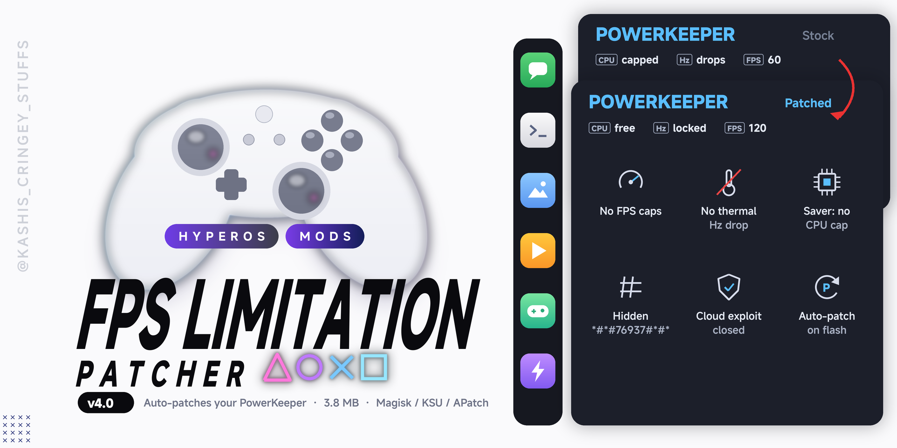

# FPS Limitation Patcher

**Removes the FPS and performance limits set by PowerKeeper and Joyose on MIUI and HyperOS.**

## Features
- No FPS caps from PowerKeeper: no 60 Hz app lists, no video/idle drops (YouTube and other video apps), no Game Turbo limits
- No per-game frame caps from Joyose (Xiaomi's game tuning app)
- No refresh-rate drop when the phone heats up
- Battery saver no longer caps CPU speed (its other savings stay on)
- Hidden PowerKeeper cloud info menu unlocked on stable ROMs: dial `*#*#76937#*#*`
- Closes a security hole that let any app point PowerKeeper's power policy to its own server
- Patches the PowerKeeper and Joyose apps already on your device during install, so it matches your ROM
- Small (about 4 MB): uses the phone's own Android runtime, no Java bundled
- Thermal safety limits are untouched, overheat protection still works

## Requirements
- MIUI or HyperOS, Android 11 or newer (up to Android 16)
- Magisk, KernelSU or APatch
- Android 13+: signature verification must be disabled

## Installation
1. Download the latest zip from [**Releases**](https://github.com/Mods-Center/FPS-Limitation-Patcher/releases/latest).
2. Flash it in the Magisk, KernelSU or APatch app (not in recovery).
3. Reboot your device.

## Notes
- Flash it again after every ROM update.
- Updating from an older version is fine, the original apps are patched again.
- Some games pick their own FPS limit per phone model (for example PUBG, Genshin); a system mod cannot change that.
- When the phone gets very hot, the system can still lower game performance to protect it.

---

Made by **[🅺🅰🆂🅷🅸](https://t.me/kakashi1v1)** · part of **[Mods Center](https://github.com/Mods-Center)**

[Website](https://modscenter.org) · [Channel](https://t.me/kashis_cringey_stuffs) · [Support group](https://t.me/bootloop_discussion) · [Report a bug](https://github.com/Mods-Center/FPS-Limitation-Patcher/issues)

